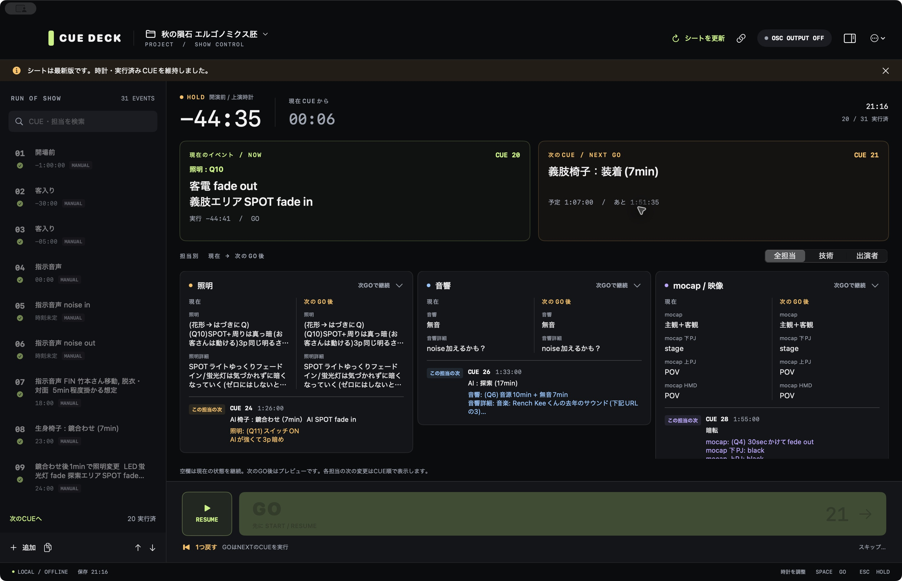
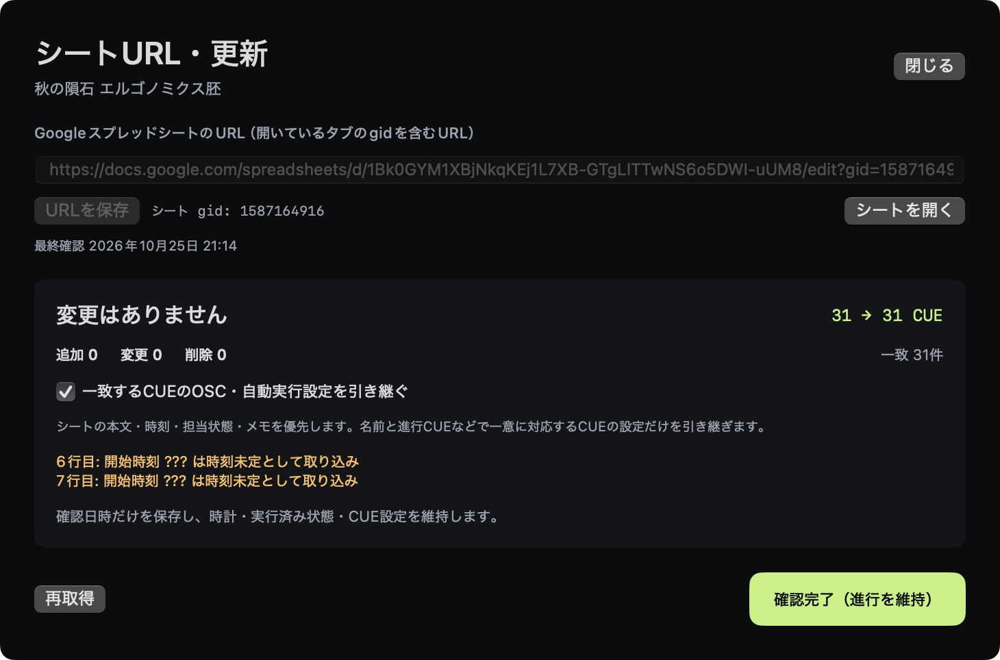

# CueDeck

舞台作品の本番進行を管理するmacOSネイティブアプリです。SwiftUI / AppKitで実装し、黒を基調に、現在のイベント・次のCUE・担当ごとの状態を確認できます。



## 主な機能

- 手動GOと、上演時計・別CUEからの経過時間による自動CUE
- 上演時計、イベント間の時間、開演前のマイナス時刻
- 現在と次のイベント、照明・音響・映像・出演者などの現在／次のGO後／次の変更
- CUEを戻す、スキップする、実行ログを書き出す
- OSC / UDP送信、送信先とCUEごとのメッセージ設定
- 1つのアプリ内でプロジェクトを作成・複製・切り替え
- Google SheetsのURLをプロジェクトごとに保存し、更新ボタンから最新版を取得
- JSON / CSV / TSV取り込み、オフライン保存、更新前のバックアップ

## 動作環境

- macOS 14以降 / Apple Silicon
- ビルドにはXcode Command Line Toolsが必要です。
- 外部ライブラリへの依存はありません。

## ビルド・インストール

```sh
git clone https://github.com/SogenHanda/CueDeck.git
cd CueDeck
./Source/build.sh
```

ビルド結果は `build/CueDeck.bundle` に生成します。インストールするにはCueDeckをHOLDにして終了したうえで、以下を実行します。

```sh
./Source/install.sh
```

`/Applications/CueDeck.app` を更新します。既存アプリは `app-backup.zip` に保存します。署名はローカルのアドホック署名で、Appleの公証は行っていません。

## 検証

```sh
./Source/verify.sh
```

時計・自動CUE・戻す操作・OSC・プロジェクト切り替え・シート更新など、重要な動作を検証します。直近の結果は [検証結果.txt](検証結果.txt) にあります。

## シートURLから更新

1. 上部のリンクアイコンを開き、CUEのタブのURL（gid付き）を登録します。
2. HOLD中に「シートを更新」を押し、追加・変更・削除を確認します。
3. 「バックアップして更新」で反映します。一致するCUEのOSC・自動実行設定は引き継げます。

変更がなければ時計・進行を維持します。変更を反映する場合は旧作品と進行をバックアップし、未実行・HOLD・OSC出力OFFで開きます。ログインなしでCSVを取得できるGoogleシートに対応し、シートの共有設定は変更しません。



## 操作と保存

詳しい操作は [操作ガイド](操作ガイド.html) と [README.txt](README.txt) を参照してください。

作品・進行は `~/Library/Application Support/CueDeck/` に保存します。端末内の進行データ、ログ、バックアップ、ビルド成果物はリポジトリに含めていません。初期作品のCUEデータと出典情報は `Source/Resources/` に含まれます。

HOLDは外部機器の停止命令ではありません。戻す操作も照明・音・映像を巻き戻しません。OSC / UDPの送信成功は受信機の実行確認ではないため、会場機器と通し稽古で確認してください。

## 構成

- `Source/`: Swiftソース、ビルド／インストールスクリプト、テスト
- `Source/Resources/`: 初期作品、出典、アイコン、同梱ガイド
- `最新版.cuedeck.json`: 現在の作品の取り込み用JSON
- `Demo-手動と自動.json`: 手動／自動CUEのデモ
